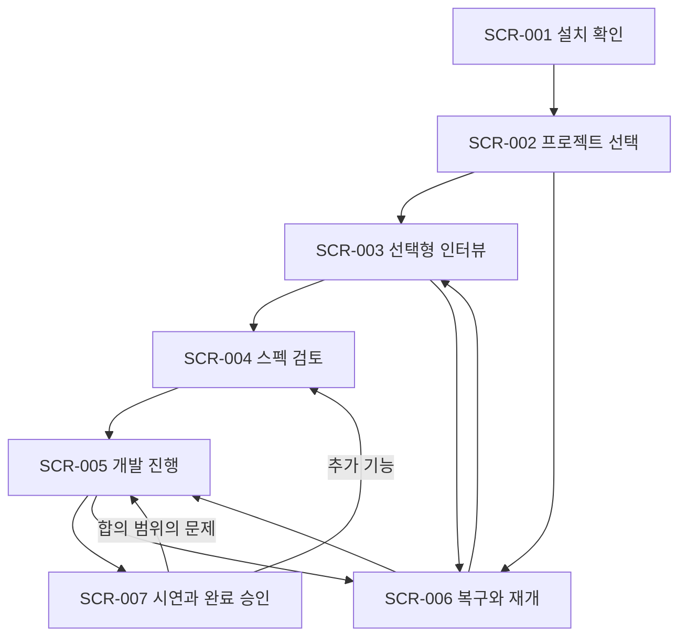
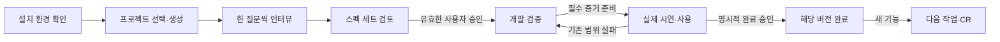
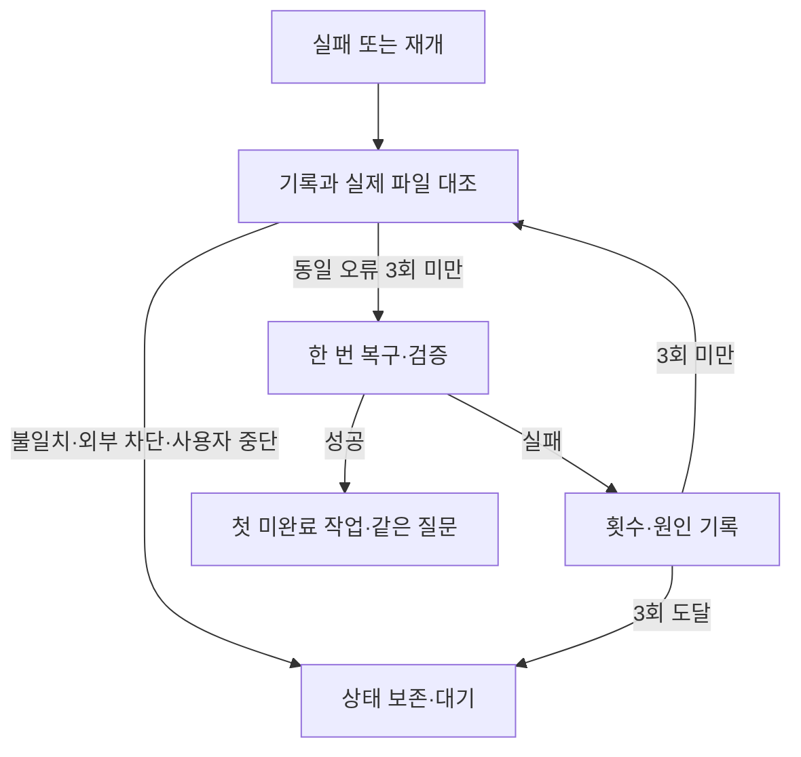

# 정보구조(IA) & 화면 목록 — build-loop

| 항목 | 내용 |
|---|---|
| 문서 버전 | v1.2 |
| 상태 | 승인(Approved) — 사용자 "스펙 문서 버전 1 승인할게" |
| 작성일 | 2026-11-20 |
| 관련 문서 | [01-prd.md](01-prd.md), [04-screens/](04-screens/) |

## 1. 사이트맵

SCR은 독립 웹페이지가 아니라 Codex 앱·CLI의 대화·선택 단계다. HTML은 검토용 표현이며 별도 웹 UI나 호스트 컴포넌트 교체를 확정하지 않는다. 목업 데이터·상태 전환은 실제 승인·검증과 무관하다.

## 2. 화면 목록

| ID | 화면명 | 경로(URL) | 접근 권한 | 관련 REQ | 정의서 | 상태 |
|---|---|---|---|---|---|---|
| SCR-001 | 설치확인 | Codex 대화 단계 | 프로젝트 사용자 | REQ-001 | [SCR-001](04-screens/SCR-001-설치확인.md) | 승인 |
| SCR-002 | 프로젝트선택 | Codex 대화 단계 | 프로젝트 사용자 | REQ-002, REQ-004 | [SCR-002](04-screens/SCR-002-프로젝트선택.md) | 승인 |
| SCR-003 | 선택형인터뷰 | Codex 대화 단계 | 프로젝트 사용자 | REQ-003, REQ-004 | [SCR-003](04-screens/SCR-003-선택형인터뷰.md) | 승인 |
| SCR-004 | 스펙검토 | Codex 대화 단계 | 프로젝트 사용자 | REQ-005, REQ-009 | [SCR-004](04-screens/SCR-004-스펙검토.md) | 승인 |
| SCR-005 | 개발진행 | Codex 대화 단계 | 프로젝트 사용자 | REQ-006, REQ-007 | [SCR-005](04-screens/SCR-005-개발진행.md) | 승인 |
| SCR-006 | 복구와재개 | Codex 대화 단계 | 프로젝트 사용자 | REQ-003, REQ-004, REQ-006, REQ-007 | [SCR-006](04-screens/SCR-006-복구와재개.md) | 승인 |
| SCR-007 | 시연과완료승인 | Codex 대화 단계 | 프로젝트 사용자 | REQ-007, REQ-008, REQ-009 | [SCR-007](04-screens/SCR-007-시연과완료승인.md) | 승인 |

## 3. 주요 사용자 흐름

### 흐름 1: 신규 프로젝트부터 사용자 완료 승인

- 관련 요구사항: REQ-001~REQ-009
- 관련 정책: POL-001, POL-005, POL-007, POL-008
- 단계 승인은 다른 단계의 승인을 대신하지 않는다. 브리프·PRD·정책 승인이 전체 스펙 승인이나 최종 완료 승인이 아니다.

### 흐름 2: 메뉴 장애·검증 실패·중단 후 재개

- 관련 요구사항: REQ-003, REQ-004, REQ-006, REQ-007
- 관련 정책: POL-003, POL-004, POL-005, POL-006
- 답변 대기·명시적 중단 중 자동 진행하지 않는다. 메뉴 장애를 텍스트 전용 인터뷰로 바꾸지 않는다.

### 비화면 동작 명세 목록 규칙

- 관리 프로젝트의 화면 없는 부분은 docs/04-interactions/REQ-###-<동작명>.md에 정의하고 IA에 파일 경로·REQ·POL·TC를 나열한다.
- 입력 예시·기대 출력·실행 순서·기본/실행중/입력없음/실패·유효성/오류 원문·POL/TC가 필수다.
- 실제 사용자 화면은 기존 SCR .md/.html 쌍을 유지한다. 비화면 명세를 화면으로 오인하거나 확인용 제품 UI를 자동 추가하지 않는다.
- 스펙 검토 SCR-004와 승인 manifest에 두 산출물 종류를 연결한다.

## 4. 공통 UI 요소

| 요소 | 설명 | 노출 화면 |
|---|---|---|
| 단계·프로젝트·버전 | 작업 대상과 현재 단계를 명시 | 전체 |
| 대안·추천·이유 | 실제 선택 UI, 자유 의견 허용 | SCR-003 및 사용자 결정 질문 |
| 상태·근거 | 통과·실패·미실행·차단 구분 | SCR-001, SCR-005, SCR-006, SCR-007 |
| 명시적 승인 | 대상·버전과 사용자 의사 연결 | SCR-004, SCR-007 |
| 목업 검토 도구 | 기본/로딩/빈/에러·앱/CLI 표현 전환 | HTML 전체. 제품 기능 아님 |

정책·화면 역참조는 승인 PRD·정책을 직접 수정하지 않고 CR 승인 후 반영한다. 현재 매핑은 본 IA와 각 화면정의서가 제공한다.

### 상태·복구 공통 정보

- 두 호스트는 같은 프로젝트 DB·문서를 재개 근거로 사용한다. revision·승인/코드/증거 버전·오류 키·시도 횟수·미확인 결과·다음 허용 작업을 표시한다.
- 낡은 revision·잠금 5초 초과·손상은 차단/대기. 승인 출처 미확인은 통과로 표시하지 않는다. 상세는 POL-001·POL-004·POL-006·POL-007 및 IMPLEMENTATION-PROPOSAL.md 참조.

## 변경 이력

| 버전 | 일자 | 변경 내용 | 관련 CR |
|---|---|---|---|
| v0.1 | 2026-11-20 | 최초 작성 | - |
| v1.0 | 2026-11-20 | 사용자 스펙 문서·화면 v1 승인 기록. 본문 내용 변경 없음 | 해당 없음 |
| v1.1 | 2026-11-20 | 비화면 명세 목록·화면 대체 검사·승인 추적 원칙 | CR-003 |
| v1.2 | 2026-11-20 | 공통 상태·승인 출처·복구 판정 정보 연결 | CR-004 |
